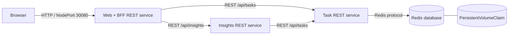

# TeamPulse

TeamPulse is a small cloud-native task board built for the Provisioning and Deployment assignment. A user can create, view, move, and delete work items in a browser. A separate insights service calls the task REST API and calculates live completion metrics. Task data is stored in Redis and survives pod restarts through a Kubernetes PersistentVolumeClaim.

The intentionally small product makes the infrastructure easy to demonstrate. In a real business scenario, pretend it serves many independent project teams and that reporting traffic is significantly heavier than task updates. Under that assumption, the web, task, and insights services have different load profiles and benefit from independent scaling.

## Architecture at a glance



| Component | Responsibility | Kubernetes workload | Scaling |
|---|---|---|---|
| Web/BFF | Serves the browser UI and exposes a same-origin REST gateway | `Deployment/web` + NodePort `Service/web` | HPA: 2–6 |
| Task API | Validates requests and owns task CRUD/data access | `Deployment/tasks` + ClusterIP `Service/tasks` | HPA: 2–8 |
| Insights API | Calls the Task API and computes live metrics | `Deployment/insights` + ClusterIP `Service/insights` | HPA: 2–10 |
| Redis | Stores tasks using append-only persistence | `Deployment/redis` + ClusterIP `Service/redis` + PVC | One replica |

The full design, trade-offs, security discussion, and component mapping are in [Architecture and evaluation](docs/ARCHITECTURE.md). A timed presentation guide is in [Demo script](docs/DEMO_SCRIPT.md), and likely viva questions are in [Question preparation](docs/QUESTIONS.md).

## REST APIs

All custom services expose REST endpoints:

| Service | Endpoint | Purpose |
|---|---|---|
| Web | `GET /healthz` | Health and serving instance |
| Web | `/api/tasks...`, `GET /api/insights` | Browser-facing REST gateway |
| Tasks | `GET/POST /api/tasks` | List or create tasks |
| Tasks | `GET/PUT/PATCH/DELETE /api/tasks/:id` | Read, replace, update, or delete one task |
| Tasks | `GET /healthz`, `GET /readyz` | Process and database readiness |
| Insights | `GET /api/insights` | Aggregated task counts and completion rate |
| Insights | `GET /healthz`, `GET /readyz` | Process and upstream readiness |

The Insights service's use of `fetch()` in `services/insights/src/server.js` is the programmatic REST client required by the assignment. The Task service is the custom REST provider.

## Quick local run with Docker Compose

Requirements: Docker with Compose support.

```sh
cd teampulse-kubernetes
docker compose up --build
```

Open <http://localhost:8080>. Stop it with `docker compose down`. The named `redis-data` volume is retained; `docker compose down -v` deliberately removes it.

## Test

The services use only Node.js built-ins, so there are no package downloads.

```sh
cd teampulse-kubernetes
make test
```

The command runs all unit tests and validates that Kustomize can render the Kubernetes resources.

## Published Docker Hub images

The three custom service images are published publicly under Docker Hub account `sagaraug04`:

- [`sagaraug04/teampulse-web:1.0.0`](https://hub.docker.com/r/sagaraug04/teampulse-web)
- [`sagaraug04/teampulse-tasks:1.0.0`](https://hub.docker.com/r/sagaraug04/teampulse-tasks)
- [`sagaraug04/teampulse-insights:1.0.0`](https://hub.docker.com/r/sagaraug04/teampulse-insights)

To rebuild and republish the same release:

```sh
cd teampulse-kubernetes
docker login
make push DOCKERHUB_USERNAME=sagaraug04 VERSION=1.0.0
make configure-images DOCKERHUB_USERNAME=sagaraug04 VERSION=1.0.0
```

The Kubernetes manifests already reference these published image names.

## Deploy to Kubernetes

Use any cluster with a default StorageClass. For automatic HPA decisions, the cluster also needs Metrics Server; without it the application still runs and every deployment can still be scaled manually.

```sh
cd teampulse-kubernetes
kubectl apply -k kubernetes
kubectl rollout status deployment/web deployment/tasks deployment/insights deployment/redis -n teampulse --timeout=180s
kubectl get pods,services,pvc,hpa -n teampulse
```

For a local cluster, the most portable browser access is:

```sh
kubectl port-forward -n teampulse service/web 8080:80
```

Then open <http://localhost:8080>. A cluster whose nodes are directly reachable can instead expose the UI on NodePort `30080`.

Useful demonstration commands:

```sh
kubectl logs -n teampulse -l app.kubernetes.io/name=teampulse --all-containers --prefix --tail=100
kubectl scale deployment/insights -n teampulse --replicas=4
kubectl get pods -n teampulse -w
BASE_URL=http://localhost:8080 make smoke-test
```

To prove persistence, create a task, note the Redis pod name, delete only that pod, wait for its replacement to become ready, and refresh the UI:

```sh
kubectl get pods -n teampulse -l app.kubernetes.io/component=database
kubectl delete pod -n teampulse REDIS_POD_NAME
kubectl get pods,pvc -n teampulse -w
```

The task remains because Redis writes append-only data to the PVC instead of the container filesystem.

## Submission links

- Source/configuration repository: [github.com/SagarKapoor1989/teampulse-kubernetes](https://github.com/SagarKapoor1989/teampulse-kubernetes)
- Video recording (5–10 minutes): **replace with the uploaded video URL**
- Docker Hub images: [web](https://hub.docker.com/r/sagaraug04/teampulse-web), [tasks](https://hub.docker.com/r/sagaraug04/teampulse-tasks), and [insights](https://hub.docker.com/r/sagaraug04/teampulse-insights)

## Repository map

```text
teampulse-kubernetes/
├── services/
│   ├── web/         # Browser UI and REST gateway
│   ├── tasks/       # CRUD API and only database client
│   └── insights/    # Analytics API and REST client
├── kubernetes/      # Deployments, Services, HPA, Secret, PVC, policies
├── scripts/         # Image configuration and API smoke test
├── docs/            # Architecture report, presentation, question prep
├── compose.yaml     # Convenient local integration environment
└── Makefile         # Repeatable test/build/push/deploy commands
```
