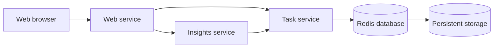

# 2. Software Architecture Design

TeamPulse uses a microservice architecture with three custom services and a Redis database.

## Components and Responsibilities

| Component | Implementation | Responsibility |
|---|---|---|
| User interface | Web microservice | Displays the task board and provides the public entry point |
| Task management | Task microservice | Creates, reads, updates and deletes tasks through a REST API |
| Statistics | Insights microservice | Calls the Task REST API and calculates task statistics |
| Data storage | Redis | Stores tasks and task identifiers |
| Persistent storage | Kubernetes PVC | Preserves Redis data when its pod restarts |
| Networking | Kubernetes Services | Provides stable internal addresses and distributes traffic |
| Scaling | Deployments and HPAs | Scales each custom service independently |

The **Web service** serves the browser interface and acts as a Backend for Frontend. It forwards `/api/tasks` requests to the Task service and `/api/insights` requests to the Insights service. It is the only service exposed outside Kubernetes.

The **Task service** validates task information and provides REST endpoints for creating, viewing, updating and deleting tasks. It is the only custom service allowed to access Redis.

The **Insights service** calls `GET /api/tasks` on the Task service and calculates totals, task statuses and completion percentage. It does not access Redis directly.

**Redis** runs as a separate database service. Append-only persistence is enabled, and its data directory is attached to a Kubernetes PersistentVolumeClaim. This allows task data to survive when the Redis pod is replaced.

## Communication

When a task is created:

1. The browser sends the request to the Web service.
2. Web forwards it to the Task service.
3. Tasks validates it and stores it in Redis.
4. The result is returned to the browser.

When statistics are requested:

1. Web sends the request to Insights.
2. Insights calls the Task REST API.
3. Tasks reads the data from Redis.
4. Insights calculates and returns the statistics.

Kubernetes Services provide stable names such as `tasks`, `insights` and `redis`, so communication does not depend on individual pod addresses.

## Architecture Principles

- **Single responsibility:** each service has one main purpose.
- **Backend for Frontend:** Web provides one public entry point.
- **Stateless services:** permanent data is stored outside the application pods.
- **Database ownership:** only Tasks communicates directly with Redis.
- **Independent scaling:** Web, Tasks and Insights have separate Deployments and HPAs.
- **Service discovery:** Kubernetes Services provide stable internal addresses.
- **Externalized configuration:** ConfigMaps store addresses and Secrets store credentials.
- **Health monitoring:** readiness and liveness probes identify unavailable pods.
- **Persistent storage:** Redis data is stored on a PVC.
- **Network security:** NetworkPolicies allow only the communication required between services.
